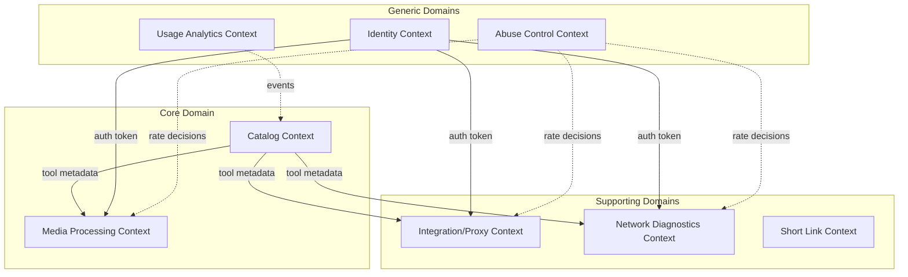
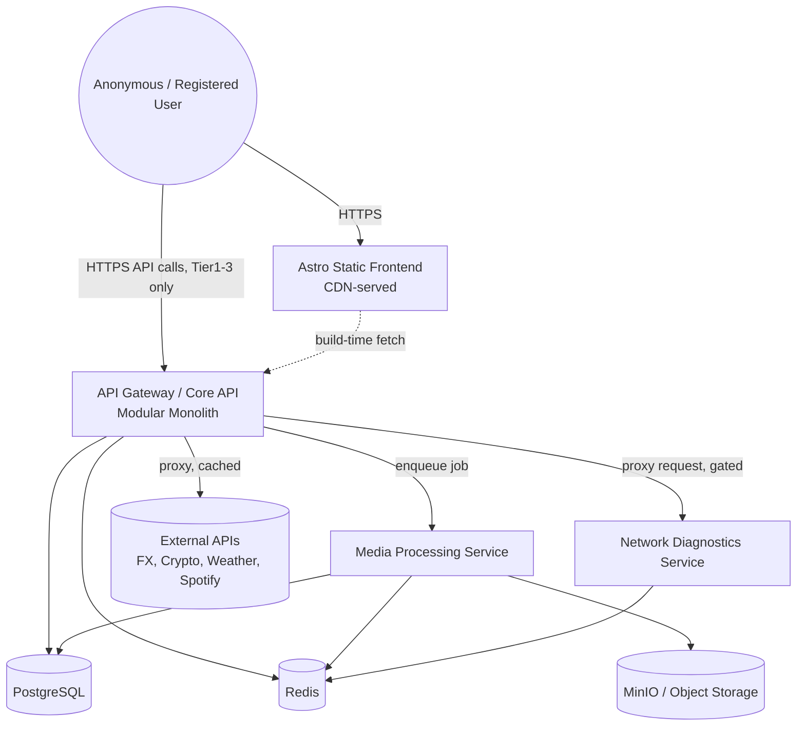
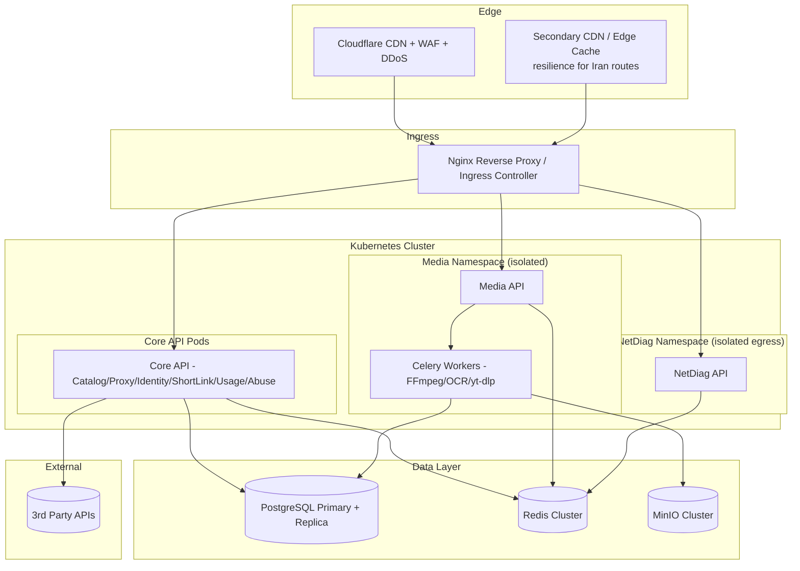
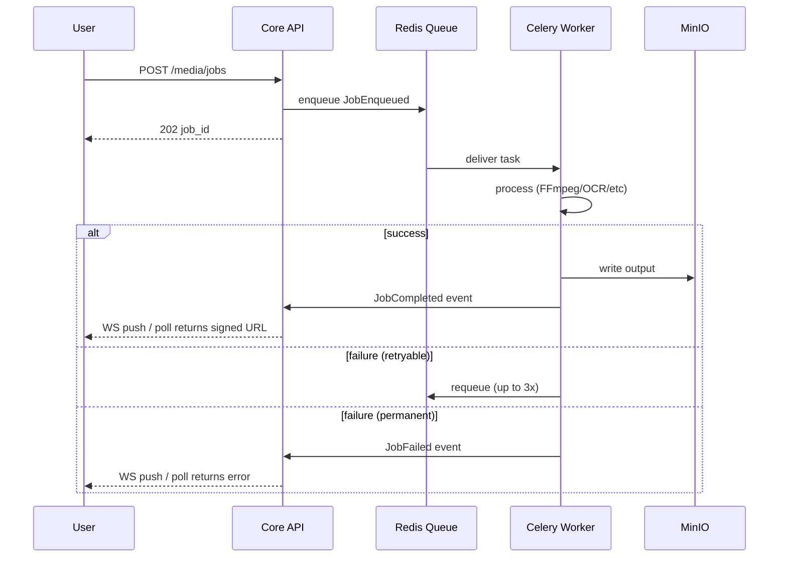
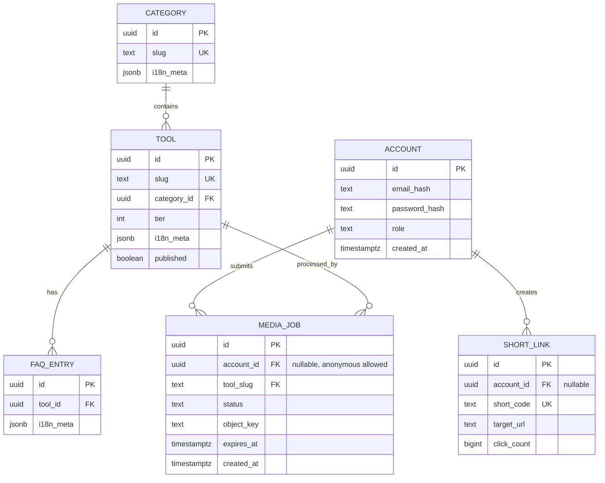
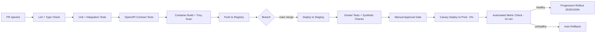
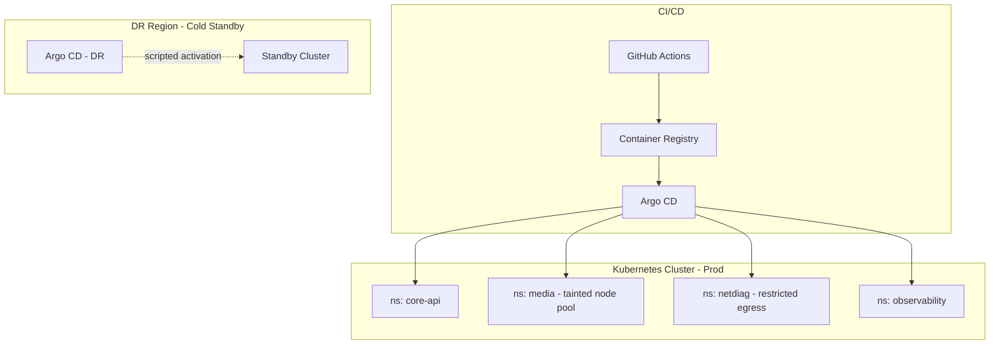
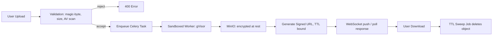
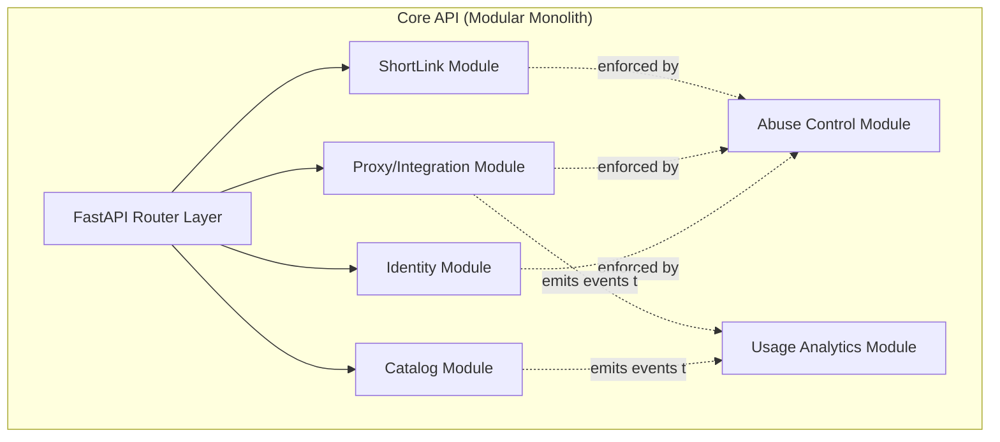

# Belboore — Enterprise Backend & Infrastructure Architecture

**Document type:** Principal Architecture Design Document
**Scope:** Backend, infrastructure, distributed systems, security, data, and operations only (frontend/UI explicitly excluded)
**Target scale:** 1K → 100M+ users over a 3-year horizon

---

## 1. Executive Summary

### Business Problem
Belboore aggregates ~150 utility tools for a bilingual (Persian/English) audience, with a stated privacy-first, no-tracking, mostly-client-side posture. The backend problem is narrower than the frontend catalog suggests: most tools (Tier 0) need **no backend at all**. The real engineering challenge is building infrastructure for the ~62 tools that do need a server — API proxying (Tier 1), compute-heavy media/document processing (Tier 2), and network-facing diagnostic tools (Tier 3) — while keeping the operating cost near zero for the 88 tools that don't, and while operating partly on Iran-accessible infrastructure with unusual connectivity and sanctions-driven constraints.

### System Goals
1. Zero-backend cost for Tier 0 tools (no server involvement, ever).
2. A single, versioned, well-governed API gateway for all backend-dependent tools instead of 62 bespoke services.
3. Strict tenant/abuse isolation for Tier 3 (network scanning, WHOIS, port scanning) — the highest legal/security-risk category.
4. Async-first processing for Tier 2 (media, PDF, OCR, downloads) so no request blocks on FFmpeg/yt-dlp.
5. No PII by default; ephemeral storage with enforced TTLs; no accounts required for 90%+ of functionality.
6. Deployable/operable from constrained, sanctioned, and bandwidth-costly infrastructure, with a CDN-first posture to minimize origin egress.

### Proposed Architecture (one line)
A **modular monolith at the core, with two explicitly separated compute-isolated services (Media, Network-Diagnostics)**, fronted by a single API Gateway, backed by Postgres + Redis + MinIO/S3, driven by an event bus for async workflows (Celery/Redis now, upgradeable to Kafka/NATS at scale), deployed on Kubernetes behind Cloudflare, with an explicit multi-region/dual-CDN strategy to mitigate Iran connectivity risk.

### Major Architectural Decisions
| Decision | Choice | Rationale |
|---|---|---|
| Overall style | Modular monolith + 2 isolated services, not full microservices | Team size (1–3 backend devs) cannot operationally sustain 15+ microservices; monolith-first with clean module boundaries preserves a later extraction path |
| API style | REST (OpenAPI) + WebSocket for job status | FastAPI native fit, matches existing stack, simplest for a small team; gRPC/GraphQL deferred until internal service-to-service fan-out justifies it |
| Async processing | Celery + Redis broker now; Kafka/NATS JetStream evaluated at Phase 3 | Celery matches FastAPI/Python ecosystem already in use; avoids operating a JVM-heavy Kafka cluster prematurely |
| Isolation boundary | Media API and Network-Diagnostics API as separate deployable services from day 1 | These are the two components with fundamentally different resource/security profiles (CPU/GPU-bound vs. raw-socket/network-bound); isolating them early avoids a costly future extraction and limits blast radius |
| Data store | PostgreSQL primary, Redis cache/queue/session, MinIO object storage | Matches project's own stated stack; Postgres is the right default for relational + optional JSONB flexibility; MinIO gives S3 semantics without cloud lock-in (useful for Iran-hosted deployments) |
| Edge | Cloudflare primary CDN + secondary CDN/self-hosted edge cache for Iran resilience | Mitigates single-point-of-failure risk given sanctions-related service interruptions historically affecting Iran-Cloudflare relationships |
| Multi-tenancy | Anonymous-by-default, optional JWT accounts, no OAuth | Matches "no external auth provider" requirement; self-issued JWT is simplest to operate and self-host |

### Expected Scale
- Year 1: 1K–50K MAU, >95% Tier 0 traffic (i.e., near-zero backend load).
- Year 2: 50K–200K MAU, Tier 1/2 traffic becomes significant (external API proxying + media jobs).
- Year 3+: 200K MAU→ multi-million aspirational; design must not *block* this, but must not be over-engineered for it today.

### Key Trade-offs
- **Monolith-first vs. microservices-first**: chosen monolith-first to match real team capacity; documented extraction seams (Section 5) so this is not a dead end.
- **Self-hosted Iran infrastructure vs. pure hyperscaler**: chosen **hybrid** — CDN/edge on Cloudflare (or equivalent), origin compute on Iran-accessible infra with a cold-standby region abroad for DR, accepting higher operational complexity in exchange for both accessibility and resilience.
- **Celery/Redis vs. Kafka**: chosen simpler stack now, accepting a later migration cost, in exchange for operability by a 1–3 person team.
- **Strict rate limiting on Tier 3 vs. openness**: chosen strict, account-gated Tier 3 access, trading some "no account required" purity for legal/abuse safety on port scanning and network tools.

---

## 2. Functional Requirements

### Core Business Capabilities (backend-relevant only)
1. **Tool Catalog & Metadata Service** — bilingual tool/category/tag/FAQ metadata, versioned, served as JSON to the static frontend at build time and via API for dynamic search.
2. **Tier 1 API Proxy** — normalize, cache, and rate-limit calls to external providers (FX rates, crypto prices, weather, air quality, Spotify preview, lyrics/music metadata).
3. **Tier 2 Media & Document Processing** — image/video/audio conversion & compression, PDF merge/compress/OCR, content downloading (yt-dlp), all async with job status and signed-URL delivery.
4. **Tier 3 Network Diagnostics** — speed test, ping, traceroute, DNS lookup, WHOIS, port scan, SSL inspection, VPN leak detection — sandboxed, rate-limited, abuse-monitored.
5. **Identity (optional)** — self-issued JWT accounts for users who want favorites, history, higher rate limits, or Tier 3 access; not required for majority of the platform.
6. **Short Link Service** — URL shortening with analytics-light click counting.
7. **Analytics/Usage Service** — aggregate, privacy-preserving tool usage counts (no PII, no per-user tracking) to drive "popular tools" ranking.
8. **Abuse & Rate-Limit Service** — cross-cutting, applied to every tier, especially Tier 3.
9. **Notification Service** (future) — job-completion notification (email/webhook) for long-running Tier 2 jobs.
10. **Community Tool Submission Pipeline (future)** — review/staging pipeline for community-contributed Tier 0 tools (this is largely a CI/CD & content-review workflow, not a runtime service).

### System Actors
- **Anonymous User** — majority actor; no account, Tier 0/1/2 access, rate-limited by IP/fingerprint.
- **Registered User** — optional JWT account; favorites, history, higher quotas, Tier 3 access.
- **Admin/Operator** — internal actor; catalog management, abuse review, infra operations.
- **Community Contributor** — submits new tools via PR/CI pipeline (not a runtime actor).
- **External API Providers** — FX/crypto/weather/music data sources (system-to-system).
- **Automated Abuse Actor** — adversarial actor explicitly modeled for Tier 3 threat analysis.

### Business Workflows (backend-relevant)
- Tier 1 request → cache check → external call → cache write → response.
- Tier 2 job submission → upload → enqueue → worker processing → object storage write → signed URL → client polls/websocket → download → TTL-based deletion.
- Tier 3 diagnostic request → auth/rate-limit gate → sandboxed execution → bounded-time result → response (no persistence beyond ephemeral logs).
- Catalog update → CMS/JSON commit → CI validation (bilingual completeness check) → build → CDN invalidation.

### Domain Boundaries (bounded contexts, elaborated in Section 4)
`Catalog`, `Proxy/Integrations`, `MediaProcessing`, `NetworkDiagnostics`, `Identity`, `ShortLinks`, `UsageAnalytics`, `AbuseControl`.

### Service Responsibilities
See Section 6 (Service Architecture) for full per-service breakdown.

### Integration Requirements
- Outbound only, to well-defined external APIs (FX, crypto, weather, Spotify, lyrics), each behind an **adapter interface** so providers are swappable without domain changes (mitigates "Third-Party API Reliability" risk called out in the project brief).
- No inbound integrations except the Astro static frontend (build-time) and optional future mobile/browser-extension clients (same API Gateway).

---

## 3. Non-Functional Requirements

### Targets by Tier
Because Tier 0 has zero backend involvement, all NFRs below apply to Tiers 1–3 and platform services only.

| Category | Target |
|---|---|
| **Availability (Tier 1 API Gateway)** | 99.9% monthly (≈43 min downtime/month) |
| **Availability (Tier 2 Media)** | 99.5% (higher tolerance — async, queue absorbs outages) |
| **Availability (Tier 3 Network)** | 99.5%, with explicit "degrade to unavailable" allowed under attack, in favor of protecting Tier 1/2 |
| **Latency — Tier 1 proxy (cached)** | p50 < 50ms, p99 < 200ms |
| **Latency — Tier 1 proxy (cache miss)** | p99 < 1500ms (bounded by external API) |
| **Latency — Tier 2 job acceptance** | p99 < 300ms (enqueue only; processing is async) |
| **Latency — Tier 3 diagnostics** | p99 < 5s per tool (hard timeout enforced) |
| **Throughput (Year-1 target)** | 200 req/s sustained at gateway, burst 1000 req/s |
| **Scalability** | Horizontal scale-out for all stateless services; documented path to 10M MAU (Section 13) |
| **Security** | OWASP ASVS Level 2 baseline; Level 3 controls for Tier 3 (network tools) |
| **Data durability** | 99.999999% (11 nines) for object storage (MinIO erasure coding / S3) |
| **Observability** | 100% of services emit structured logs, metrics, and traces; MTTD < 5 min for P1 incidents |
| **Compliance** | GDPR-aligned data minimization (even though EU is not the primary market, this future-proofs EU traffic); Iranian data-residency awareness for Iran-hosted origin |
| **Disaster Recovery** | RPO ≤ 15 min (Postgres), RPO ≤ 1 hr (object storage), RTO ≤ 4 hr for full platform restore |
| **Fault tolerance** | No single external API outage may degrade more than the affected Tier 1 tool (bulkhead isolation) |
| **Cost efficiency** | Backend infra cost target < $0.01 per MAU at Phase 2 scale |

### SLA / SLO / SLI Definitions
- **SLI examples**: gateway request success rate, p99 latency per endpoint class, Tier 2 job success rate, Tier 3 timeout rate, cache hit ratio.
- **SLO examples**: "99.9% of Tier 1 cached requests complete under 200ms, measured over rolling 30 days"; "99.5% of Tier 2 jobs complete successfully within their declared SLA window (e.g., video transcode < 5 min for files < 200MB)".
- **SLA** (external, if ever offered commercially via Freemium API): 99.5% monthly uptime for paid API tier, with service credits — everything else is best-effort.

### RPO/RTO Summary
| System | RPO | RTO |
|---|---|---|
| PostgreSQL (accounts, catalog, short links) | 15 min (WAL streaming + PITR) | 1 hr |
| Redis (cache/queue) | Best-effort (0, treated as ephemeral — rebuildable) | 15 min |
| MinIO/Object storage | 1 hr (async cross-region replication) | 4 hr |
| Full platform | — | 4 hr |

---

## 4. Domain-Driven Design

### Bounded Contexts


### Context Descriptions

**Catalog Context (Core)**
- *Aggregates*: `Tool` (root), `Category`, `Tag`, `FAQEntry`.
- *Entities*: `Tool` (id, slug, tier, category_id, i18n metadata).
- *Value Objects*: `LocalizedText{fa, en}`, `SEOMetadata`, `ToolTier` (enum: 0/1/2/3).
- *Domain Services*: `CatalogSearchService`, `CatalogValidationService` (enforces bilingual completeness).
- *Domain Events*: `ToolPublished`, `ToolDeprecated`, `CategoryRestructured`.

**Integration/Proxy Context (Supporting)**
- *Aggregates*: `ProxyRequest` (root), `CachedResponse`.
- *Value Objects*: `ProviderAdapterConfig`, `CacheTTLPolicy`.
- *Domain Services*: `ProviderAdapter` interface (implemented per provider: FXAdapter, CryptoAdapter, WeatherAdapter, SpotifyAdapter).
- *Domain Events*: `ExternalCallFailed`, `ProviderFallbackTriggered`.

**Media Processing Context (Core)**
- *Aggregates*: `MediaJob` (root) — contains `JobInput`, `JobOutput`, `JobStatus`.
- *Entities*: `MediaJob(id, tool_slug, status, created_at, expires_at)`.
- *Value Objects*: `SignedDownloadURL`, `FileFingerprint`, `ProcessingParams`.
- *Domain Services*: `TranscodeService`, `CompressionService`, `OCRService`, `DownloaderService`.
- *Domain Events*: `JobEnqueued`, `JobStarted`, `JobCompleted`, `JobFailed`, `JobExpired` (triggers deletion).

**Network Diagnostics Context (Supporting, highest isolation)**
- *Aggregates*: `DiagnosticRequest` (root, ephemeral — never persisted beyond logs).
- *Domain Services*: `PortScanService`, `DNSLookupService`, `SSLInspectionService`, `WhoisService`, `SpeedTestService`.
- *Domain Events*: `DiagnosticExecuted`, `AbuseSignalRaised`.

**Identity Context (Generic)**
- *Aggregates*: `Account` (root, optional).
- *Value Objects*: `JWTClaims`, `RateLimitTier`.
- *Domain Events*: `AccountCreated`, `AccountDeleted` (triggers cascading data purge).

**Short Link Context (Supporting)**
- *Aggregates*: `ShortLink` (root).
- *Domain Events*: `LinkCreated`, `LinkClicked` (aggregated, not per-user).

**Usage Analytics Context (Generic)**
- *Aggregates*: `UsageCounter` (root; append-only, anonymous, aggregate counters only — no per-user event stream, by design, to preserve the privacy commitment).

**Abuse Control Context (Generic, cross-cutting)**
- *Aggregates*: `RateLimitBucket`, `AbuseScore`.
- *Domain Services*: `AbuseDetectionService`, consumed synchronously by every Tier 1–3 request path.

### Context Map
- **Catalog → all others**: Open Host Service (published metadata JSON/API), Conformist consumers.
- **Identity → Proxy/Media/NetDiag**: Shared Kernel via JWT (standard claims contract only, no shared database).
- **Abuse Control → Proxy/Media/NetDiag**: Customer/Supplier — Abuse Control dictates allow/deny, other contexts must obey but don't own the logic.
- **Usage Analytics**: pure downstream consumer of domain events, never upstream.

### Domain Decomposition Strategy
Decomposition follows **resource/security isolation first, business-capability second**. Media Processing and Network Diagnostics are split into independently deployable services immediately, because their resource profiles (CPU/FFmpeg vs. raw sockets/network egress) and threat models are incompatible with sharing a process or a Kubernetes node pool with the low-risk API Gateway. Catalog, Proxy, Identity, ShortLink, Usage, and Abuse Control start as **modules within a single "Core API" deployable** (modular monolith), each with its own Postgres schema and no cross-module direct SQL joins — only in-process service interfaces — so any one module can be extracted into its own service later with minimal rewrite (see Section 5 evolution path).

---

## 5. High-Level Architecture

### Style Selection: Modular Monolith (Core) + Isolated Services (Media, Network Diagnostics)

**Why not full microservices:** The stated team is 1–3 backend developers maintaining a 150-tool catalog. Fifteen independently deployed microservices would multiply operational burden (CI/CD, on-call, service discovery, distributed tracing overhead) far beyond what the team can sustain, and the project's own risk register identifies "Backend Team Gap" and "Volunteer Burnout" as top risks. Microservices would actively worsen both.

**Why not a pure monolith:** Media processing (FFmpeg/yt-dlp/OCR) is CPU/GPU/disk-intensive and must scale and fail independently from the low-latency API gateway. Network Diagnostics performs raw socket operations, port scans, and outbound scans against arbitrary hosts — this is the single highest legal/security/abuse risk in the system and must be network-isolated (separate egress path, separate security group, separate rate-limit budget) so it can never become a pivot point into the rest of the platform, and so a Tier 3 abuse event (e.g., the platform's IP getting blacklisted for scanning) cannot take down Tier 1/2.

**Benefits**: One codebase/CI pipeline for 80% of backend logic (Catalog, Proxy, Identity, ShortLink, Usage, Abuse), two hard security/resource boundaries where it matters most, low operational headcount required, clear extraction seams for future growth.

**Trade-offs**: Core API is a single deploy unit — a bad deploy affects Catalog+Proxy+Identity+ShortLink simultaneously (mitigated by blue/green deploys, canary, and strict module boundaries preventing shared mutable state). Team must maintain discipline on module boundaries (enforced via linting/import-boundary tooling, e.g., `import-linter` for Python) or the monolith will decay into a "big ball of mud."

**Evolution path**: When any one module's traffic/team ownership justifies it (e.g., Proxy becomes multi-provider and needs its own release cadence), extract it behind the same interface contracts already enforced internally — no big-bang rewrite required.

### System Context Diagram


### Container Diagram


---

## 6. Service Architecture

### 6.1 API Gateway / Core API (Modular Monolith)
- **Responsibilities**: request routing, JWT auth verification, rate limiting (via Redis token bucket), OpenAPI-documented REST endpoints, Catalog CRUD (admin), Proxy orchestration, ShortLink CRUD, Usage aggregation, Abuse decisioning.
- **Inputs**: HTTPS REST requests from frontend/clients.
- **Outputs**: JSON responses; enqueued jobs (to Media); proxied requests (to NetDiag, to external APIs).
- **Dependencies**: PostgreSQL, Redis, external provider APIs, Media API, NetDiag API.
- **Ownership**: Core backend team.
- **Failure scenarios**: Postgres primary down → serve read-only cached catalog from Redis, degrade writes (ShortLink creation, account actions) with 503 + Retry-After; Redis down → fail closed on rate limiting (deny rather than allow, to protect against abuse spikes) but Catalog reads fall back to Postgres directly.
- **Recovery**: automated failover to Postgres replica (promoted via Patroni/pg_auto_failover), Redis Sentinel/Cluster automatic failover.
- **Scaling**: stateless horizontal pod autoscaling on CPU + request-queue-depth custom metric.

### 6.2 Authentication & Authorization (module within Core API)
- Self-issued JWT (RS256), short-lived access tokens (15 min) + refresh tokens (30 days, rotated, stored hashed).
- No OAuth/external IdP, per project requirements. Optional email-based magic-link or password+argon2id.
- Authorization: simple RBAC (`anonymous`, `registered`, `admin`) — ABAC not justified at current complexity, but claims structure leaves room for it.

### 6.3 Catalog Service (module)
- Source of truth for tool/category/tag/FAQ bilingual metadata; serves both the Astro build-time fetch and runtime search API.
- CI-enforced invariant: every `Tool` must have complete `fa` and `en` fields, or the publish pipeline rejects it (encodes the "native bilingual" requirement into code, not just policy).

### 6.4 Proxy/Integration Service (module)
- One `ProviderAdapter` implementation per external API. Each adapter declares its own cache TTL, timeout, and circuit breaker config.
- Central `ProxyOrchestrator` handles: cache-check → adapter call → cache-write → response, with per-provider circuit breakers (see Section 14).

### 6.5 Media Processing Service (isolated deployable)
- **Responsibilities**: accept upload/URL, validate, enqueue Celery task, worker executes FFmpeg/ImageMagick/OCR (Tesseract)/yt-dlp in a **sandboxed, resource-quota'd container** (gVisor or Kata Containers recommended for kernel-level isolation given untrusted file inputs), write result to MinIO, generate short-lived signed URL, emit `JobCompleted`.
- **Inputs**: file upload or source URL, tool_slug, processing params.
- **Outputs**: job_id (sync), signed download URL (async, via poll or WebSocket).
- **Dependencies**: Redis (broker + job status), MinIO, Postgres (job metadata only, not file content).
- **Failure scenarios**: worker crash mid-job → task requeued (Celery `acks_late` + visibility timeout), max 3 retries then `JobFailed` + user notified; malicious/oversized file → rejected at validation before enqueue (magic-byte checking, not just extension).
- **Recovery**: dead-letter queue for permanently failed jobs, reviewed by ops.
- **Scaling**: worker pool autoscaled on **queue depth**, not CPU (queue depth is the leading indicator); separate worker pools per job type (video transcode vs. image compress) so a video backlog doesn't starve fast image jobs — implemented as separate Celery queues with dedicated worker deployments.

### 6.6 Network Diagnostics Service (isolated deployable, isolated egress)
- **Responsibilities**: execute bounded, timeout-enforced network probes (ping, traceroute, DNS, WHOIS, port scan, SSL check, speed test) against user-specified or self targets only.
- **Critical constraint**: this service must run in its own network namespace/VPC subnet with **its own dedicated outbound IP range**, separate from Core API and Media, so that abuse-driven IP reputation damage or upstream blocking never affects the rest of the platform.
- **Failure scenarios**: outbound scan abuse detected → auto-throttle/ban the account or IP, alert ops; upstream IP blacklisted → rotate egress IP pool (requires provisioning a small pool in advance) or degrade the specific tool to "temporarily unavailable" rather than cascading.
- **Scaling**: horizontal, but capped harder than other services — Tier 3 concurrency is intentionally the most constrained resource in the system.
- **Access control**: require a registered account + stricter per-account rate limits for port scanning / WHOIS specifically (these are the two named legal-risk tools); ping/DNS/SSL-check can remain anonymous-accessible with lighter limits.

### 6.7 Background Workers / Scheduler
- Celery beat (or Kubernetes CronJobs) for: expired-job cleanup (MinIO TTL sweep), cache-warming for high-traffic Tier 1 endpoints (e.g., FX rates refreshed every 60s regardless of request, so users never pay the cache-miss cost), usage-counter rollups, abuse-score decay.

### 6.8 Notification Service (Phase 2+)
- Thin service for Tier 2 job-completion notifications (email via transactional provider, or webhook). Not required for MVP since polling/WebSocket covers the primary use case.

### 6.9 Search Service
- Phase 1: Postgres full-text search (bilingual, `tsvector` with `simple` + custom Persian-friendly normalization) over Catalog — sufficient for ~150 tools.
- Phase 3+: if community tool submissions or content (not just tool metadata) grow substantially, evaluate OpenSearch/Meilisearch — explicitly **not justified today**, called out to avoid premature complexity.

---

## 7. API Architecture

### Style
REST (OpenAPI 3.1, auto-generated by FastAPI) for all synchronous endpoints; WebSocket for Tier 2 job-status streaming; no GraphQL (no client need for flexible querying — the tool catalog is small and well-known) and no public gRPC (reserved as an internal-only option if Core↔Media/NetDiag traffic ever needs it; today plain internal REST over the cluster network is sufficient at this scale).

### Versioning
- URL-path versioning: `/api/v1/...`. Breaking changes → `/api/v2/...` with both versions live for a minimum deprecation window (6 months), announced via `Deprecation` and `Sunset` HTTP headers.

### Authentication & Authorization
- `Authorization: Bearer <JWT>` for registered users; anonymous requests identified by a signed, rotating device/IP fingerprint token issued on first contact (used purely for rate limiting, never stored as PII, never logged with the raw IP beyond the rate-limit window).

### Rate Limiting
- Redis-backed sliding-window token bucket, tiered:
  - Anonymous: 60 req/min general, 5 req/min for Tier 3 non-account tools.
  - Registered: 300 req/min general, 30 req/min Tier 3.
  - Tier 2 job submission: separate quota (e.g., 10 jobs/hour anonymous, 50/hour registered) independent of general API quota, since jobs are expensive.
- `429 Too Many Requests` with `Retry-After` header; limits documented in OpenAPI.

### Pagination
- Cursor-based (opaque, base64-encoded) for all list endpoints (Catalog search, admin lists) — avoids offset-pagination performance decay and is stable under concurrent writes.

### Error Handling
- RFC 9457 (`application/problem+json`) structured errors: `{type, title, status, detail, instance, trace_id}`. Every error includes `trace_id` correlating to distributed tracing.

### Idempotency
- All `POST` endpoints that create a resource (short links, media jobs) accept an optional `Idempotency-Key` header; server caches the response for 24h keyed on `(endpoint, key)` in Redis, returning the original response on retry — critical for Tier 2 job submission over flaky Iran network connections.

### API Governance
- OpenAPI spec is the contract of record, generated from code but **linted in CI** (Spectral) against a house style guide (naming, error shape, pagination shape) so 62 backend tools don't organically diverge into 62 inconsistent mini-APIs.
- Contract tests run in CI against the spec before merge.

### Example Contract (Tier 2 job submission)
```
POST /api/v1/media/jobs
Content-Type: multipart/form-data
Idempotency-Key: 7c9e...

{ tool_slug: "video-compress", file: <binary>, params: { target_size_mb: 25 } }

202 Accepted
{
  "job_id": "job_9f1c...",
  "status": "queued",
  "status_url": "/api/v1/media/jobs/job_9f1c.../status",
  "ws_url": "wss://api.belboore.com/v1/media/jobs/job_9f1c.../stream",
  "expires_at": "2026-07-04T12:00:00Z"
}
```

---

## 8. Event-Driven Architecture

### Broker Choice
- **Phase 1–2**: Redis Streams / Celery (Redis as broker) — matches team skill set, minimal ops overhead, sufficient throughput at <1K events/sec.
- **Phase 3+ trigger**: if cross-service event fan-out (e.g., Usage Analytics consuming from 5+ producers, or Notification Service needing durable multi-consumer semantics) grows past what Redis Streams comfortably guarantees, migrate to **NATS JetStream** (lighter operational footprint than Kafka, good fit for a small team) or Kafka if volume genuinely reaches internet scale.

### Event Categories
- **Domain events** (intra-module): `ToolPublished`, `JobStatusChanged` — in-process, no broker needed inside the monolith.
- **Integration events** (cross-service): `JobEnqueued` (Core→Media), `JobCompleted`/`JobFailed` (Media→Core, for notification/usage), `DiagnosticExecuted` (NetDiag→Abuse Control), `AbuseSignalRaised` (any service→Abuse Control).

### Event Schema (example)
```json
{
  "event_id": "evt_...",
  "event_type": "media.job.completed",
  "version": 1,
  "occurred_at": "2026-07-03T10:00:00Z",
  "job_id": "job_9f1c...",
  "tool_slug": "video-compress",
  "status": "success",
  "trace_id": "trc_..."
}
```
All events versioned (`version` field); consumers must tolerate unknown fields (additive-only evolution).

### Command vs Event Processing
- **Commands** (imperative, expects specific outcome): `SubmitMediaJob`, `CreateShortLink` — handled synchronously at the API boundary, may result in an event being published.
- **Events** (facts, broadcast): consumed by zero or more downstream listeners (Usage Analytics, Notification, Abuse Control) without the producer knowing/caring who listens.

### Saga: Media Job Lifecycle (choreography, not orchestration — only 2 participants)


### Reliability Patterns
- **Retry policy**: exponential backoff with jitter, max 3 attempts for transient failures (network, external API 5xx); no retry for validation errors (4xx).
- **Dead-letter queue**: failed-after-retry tasks land in a DLQ, alertable, manually replayable by ops.
- **Event replay**: Redis Streams consumer groups retain a bounded window (e.g., 24h) allowing a crashed consumer to replay from last-acked offset; for longer replay needs, events are also durably logged to Postgres (`event_log` table) as an audit trail.
- **Ordering**: per-job ordering guaranteed (single partition/key = job_id); no global ordering guarantee needed since jobs are independent.
- **Delivery semantics**: at-least-once with idempotent consumers (job state transitions are idempotent by design — e.g., "mark completed" is a no-op if already completed).

---

## 9. Database Architecture

### Storage Selection Summary
| Store | Role | Why |
|---|---|---|
| PostgreSQL | System of record: accounts, catalog, short links, job metadata, event log | ACID, strong relational + JSONB flexibility for bilingual fields, mature replication/backup tooling, matches team familiarity |
| Redis (Cluster) | Cache, rate-limit buckets, Celery broker, session/job-status ephemeral store | Sub-ms latency, native TTL, pub/sub for WebSocket status push |
| MinIO (or S3) | Object storage for uploaded/processed media, PDFs | S3-compatible (portable off Iran-hosted infra if needed), erasure-coded durability, native lifecycle/TTL policies for auto-deletion (privacy requirement) |
| Postgres full-text search | Catalog search | Sufficient scale (~150–1000 tools), avoids operating a separate search cluster prematurely |

No dedicated analytical database/warehouse is justified until Usage Analytics volume genuinely requires OLAP (Phase 3+); until then, aggregate counters live in Postgres with scheduled rollups. No time-series DB is needed unless infrastructure metrics volume outgrows Prometheus's own TSDB (unlikely before very large scale).

### CAP / ACID vs BASE
- **PostgreSQL**: CP system — chosen for accounts, catalog, and short links because correctness (unique slugs, referential integrity, no lost writes) matters more than availability during a partition. ACID guarantees used directly for `ShortLink` uniqueness and `Account` email uniqueness.
- **Redis (cache role)**: AP, BASE — cache/rate-limit data is allowed to be eventually consistent or even lost (rebuildable from Postgres or simply re-computed); this is why Redis is never the system of record for anything durable.
- **MinIO**: tuned for AP with strong-enough read-after-write consistency for the single-writer-per-object pattern used here (each job writes its own unique object key, so there's no concurrent-write conflict to resolve).

### Partitioning / Replication / Sharding
- **PostgreSQL**: single primary + 1–2 read replicas (Phase 1–2). Partition the `usage_counters` and `event_log` tables by month (native Postgres declarative partitioning) to bound table growth and simplify retention/deletion. Sharding is **not** required until MAU is in the multi-million range with heavy write contention — call this out explicitly as a non-goal for now to avoid premature complexity, with `job_metadata` and `usage_counters` identified as the first candidates to shard by `tenant/account_id` hash if that day comes.
- **Redis**: Redis Cluster (3 primary + 3 replica minimum) for HA from day one, since it's in the critical path for rate limiting (a single-node Redis failure must not open the platform to unlimited abuse).
- **MinIO**: distributed mode with erasure coding (minimum 4-node) for durability; cross-region async replication to a secondary bucket (different provider/region) for DR.

### Backup & Recovery
- PostgreSQL: continuous WAL archiving + nightly base backup (pgBackRest), PITR tested quarterly via game-day restore drills.
- MinIO: versioning enabled on all buckets holding non-ephemeral data (job metadata not applicable — files are ephemeral by design/TTL, but the *bucket configuration itself* and any retained originals for dispute/audit are versioned and replicated cross-region).
- Redis: RDB snapshotting (hourly) purely as a warm-restart optimization — not relied upon as a durability guarantee, since Redis here never holds source-of-truth data.

### Indexing Strategy
- Catalog: GIN index on `tsvector` search column (bilingual), btree on `slug` (unique), `category_id`, `tier`.
- ShortLink: btree unique index on `short_code`.
- MediaJob: btree on `(account_id, created_at)` for user history, index on `expires_at` for the TTL sweep job, btree on `status` for queue-depth dashboards.
- Accounts: unique index on `email_hash` (store a hash for lookup, not raw email in the index, to reduce PII exposure surface — see Section 11).

### Data Lifecycle Policies
- Uploaded/processed media: hard TTL (default 1 hour post-completion, configurable per tool, max 24 hours), enforced by both MinIO lifecycle rules **and** an application-level sweep job (defense in depth — never rely on a single deletion mechanism for a privacy commitment).
- Network diagnostic requests: never persisted beyond structured logs used for abuse detection (retained 30 days, then purged).
- Usage analytics: aggregate-only, no per-user event retained; raw request logs feeding aggregation retained 7 days then deleted.
- Accounts: deletion cascades (via `AccountDeleted` domain event) purge favorites/history within 24 hours, consistent with a right-to-erasure posture.

### Example ER Diagram (Core schemas)


---

## 10. Caching Architecture

### Layers
1. **CDN cache (Cloudflare)** — all static frontend assets (Astro build output) cached at edge with long TTL + content-hashed filenames for cache-busting; Tier 1 API responses that are safe to cache publicly (e.g., FX rates) can also be cached at the CDN edge with short TTL (30–60s) via `Cache-Control: public, max-age=60, stale-while-revalidate=30`, dramatically reducing origin load for the platform's highest-traffic proxy tools.
2. **Distributed cache (Redis)** — origin-side cache for all Tier 1 proxy responses, keyed by `(provider, normalized_params)`, TTL per-provider (e.g., FX: 60s, weather: 10 min, crypto: 15s).
3. **Local/in-process cache** — small LRU cache inside each Core API pod for Catalog metadata (rarely changes, safe to cache 5 min in-process to shave Redis round-trips off the hottest path — catalog reads).
4. **Database query cache** — not a separate technology; Postgres's own shared buffer cache plus the Redis layer above make a dedicated query-cache tier unnecessary at this scale.

### Invalidation
- CDN: content-hash filenames for static assets (no invalidation needed, just new URLs); explicit `purge` API call from CI on Catalog publish for the few dynamic bilingual metadata endpoints served through CDN.
- Redis: TTL-based expiry as the primary mechanism (never rely solely on explicit invalidation for external-API caches, since staleness tolerance already exists); explicit key deletion on `ToolPublished`/`CategoryRestructured` events for Catalog cache.
- In-process LRU: short TTL (5 min) makes explicit invalidation unnecessary; acceptable staleness window is documented and agreed with product.

### Eviction Policy
- Redis: `allkeys-lru` for the cache database; **separate logical Redis database/cluster** for rate-limiting and Celery broker data so cache eviction pressure never evicts rate-limit counters (which would be a security bug, not just a performance one).

### Cache Warming
- Scheduled job pre-fetches the highest-traffic Tier 1 endpoints (FX, crypto, weather for major cities) on their TTL cadence regardless of user traffic, so real user requests are cache-hit >99% of the time.

### Consistency
- Cache is explicitly **not** the source of truth for anything; every cached value is reproducible from Postgres or the external provider, so no distributed cache-consistency protocol is needed — the system tolerates "eventually correct within TTL" everywhere caching is used, which is an explicit, documented product decision for this class of tools (a 15-second-stale crypto price is acceptable for a free utility).

---

## 11. Security Architecture

### AuthN / AuthZ
- Self-issued JWT (RS256, rotating signing keys via KMS), 15-min access + 30-day rotating refresh tokens (refresh tokens stored server-side hashed, revocable — protects against long-lived token theft).
- RBAC: `anonymous`, `registered`, `admin`. ABAC not currently justified; RBAC claims structure (`role`, `scopes[]`) leaves room to add attribute checks (e.g., per-tool scopes) without a redesign.
- No OAuth/external IdP by design (project requirement) — accepted trade-off: platform owns full credential security burden (mitigated via argon2id hashing, no plaintext storage, breach-monitoring integration e.g. HaveIBeenPwned k-anonymity check on signup).

### Session Management
- Stateless JWT for API calls; refresh-token rotation with reuse detection (if a rotated-out refresh token is presented again, treat as compromise and revoke the entire token family).

### Zero-Trust Posture
- No implicit trust between Core API, Media, and NetDiag services — all internal calls authenticated via short-lived service-to-service mTLS certificates (issued via a service mesh or cert-manager + SPIFFE/SPIRE), not just "it's inside the cluster so it's trusted." This matters specifically because NetDiag has a different, higher risk profile and must never be reachable except via authenticated calls from Core API.

### Secrets Management
- HashiCorp Vault (or cloud KMS equivalent) for all credentials, API keys (external providers), JWT signing keys, database credentials — no secrets in environment variables/config files in source control, dynamic short-lived DB credentials issued per-pod where feasible.

### Encryption
- In transit: TLS 1.3 everywhere (client↔CDN, CDN↔origin, service↔service via mTLS, service↔database).
- At rest: Postgres transparent data encryption / encrypted volumes; MinIO server-side encryption (SSE-S3 or SSE-KMS) for all objects, mandatory (even though files are ephemeral, "ephemeral but breached" is still a breach).
- KMS/HSM: cloud KMS or self-hosted (e.g., Vault's transit engine) for key management if self-hosting in Iran without access to a Western cloud KMS.

### Audit Logging
- All admin actions (catalog edits, account actions, abuse overrides) written to an append-only audit log table, separate from application logs, retained 1 year.

### Threat Detection & DDoS Protection
- Cloudflare WAF + DDoS mitigation at edge (L3/L4/L7).
- Application-layer anomaly detection on Tier 3 (NetDiag) specifically — sudden spike in port-scan requests from a single account/IP triggers auto-throttle and ops alert.

### API Protection / OWASP Controls
- Input validation via Pydantic schemas on every endpoint (reject unknown fields, strict types).
- File upload validation: magic-byte/content-type verification (not extension-based), size limits enforced at Nginx **and** application layer, virus/malware scanning (ClamAV) on all Tier 2 uploads before processing.
- SSRF protection on NetDiag and Downloader tools specifically: outbound requests validated against an allow/deny list (block RFC1918 private ranges, cloud metadata endpoints `169.254.169.254`, localhost) — critical because both "network diagnostics" and "URL downloaders" are classic SSRF vectors.
- Standard OWASP ASVS controls: parameterized queries only (ORM), CSRF not applicable to a pure JSON API (no cookie-based sessions), CSP headers served by the frontend layer (out of scope here but coordinated), security headers (HSTS, X-Content-Type-Options, etc.) enforced at Nginx/CDN.

### Threat Modeling (STRIDE summary)
| Threat | Primary target | Mitigation |
|---|---|---|
| Spoofing | JWT forgery | RS256 asymmetric signing, key rotation, short TTL |
| Tampering | Media job params, file uploads | Signed job records, content validation, checksums |
| Repudiation | Admin catalog edits | Append-only audit log |
| Information Disclosure | PII in logs, cross-account job access | Structured logging with PII redaction, object-level access control (signed URLs scoped to job owner) |
| Denial of Service | Tier 2/3 resource exhaustion | Queue-based backpressure, per-account quotas, sandboxed worker resource limits (cgroups) |
| Elevation of Privilege | NetDiag as pivot into internal network | Network-isolated egress, SSRF allowlist, no shared credentials with Core API |

### Attack Surface Analysis
The largest attack surface is **Tier 2 file processing** (arbitrary user-uploaded content fed to FFmpeg/Tesseract/yt-dlp, all historically sources of CVEs) and **Tier 3 outbound network access** (SSRF, abuse-as-a-scanning-proxy). Both are addressed via sandboxed execution (gVisor/Kata) + strict egress control, which is why these two are the services explicitly isolated in Section 5/6 rather than modules in the monolith.

---

## 12. Infrastructure Architecture

### Cloud/Hosting Strategy
**Hybrid**: primary compute origin hosted on Iran-accessible infrastructure (per the project's own stated geopolitical-access value proposition) with a **cold-standby DR region on an international provider** (e.g., a European or UAE region) for disaster recovery and to host the secondary CDN edge. Static assets and cacheable API responses served via Cloudflare (or a comparable CDN with strong presence reachable from Iran) as the primary path — this means the *majority* of traffic never touches Iran-hosted origin at all, minimizing exposure to local bandwidth-cost and connectivity-stability risk called out in the project's own risk register.

### Regions / AZs
- Primary region: Iran-hosted provider, minimum 2 AZs (or 2 independent facilities if true AZs aren't offered by the local provider) for intra-region HA.
- DR region: international, async-replicated, warm-standby database + cold-standby compute (scripted to spin up via IaC within RTO budget, not run 24/7, for cost efficiency).

### Networking / VPC
- Single VPC per environment (staging/prod), three subnet tiers: public (ingress/load balancer only), private-app (Core API, Media), private-restricted (NetDiag — separate route table, separate NAT gateway/dedicated egress IP pool, explicit no-route to private-app subnet except via the authenticated API call path).
- Kubernetes NetworkPolicies enforce namespace-level isolation matching the VPC subnet isolation (defense in depth) — NetDiag pods cannot initiate connections to Postgres or Media pods, only to Redis (for rate-limit checks) and out to the internet.

### Service Mesh
- Linkerd (lighter-weight than Istio, better fit for a small ops team) for mTLS between Core/Media/NetDiag, retries, and traffic-level observability — introduced once the number of internal service-to-service calls justifies it (Phase 2), not required for MVP where Core API is still a monolith talking to only 2 external services.

### Kubernetes / Container Orchestration
- Single multi-node K8s cluster (managed if available in-region, self-managed via kubeadm/k3s if not), separate node pools: `general` (Core API), `compute` (Media workers — larger CPU/memory, potentially GPU nodes later for AI-assisted OCR/upscaling if ever added), `restricted` (NetDiag, tainted so only NetDiag pods schedule there, with the dedicated egress NAT).
- Serverless (e.g., Knative or cloud Functions) is **not** the primary compute model — rejected because: (a) sanctioned/Iran-hosted infra rarely offers mature serverless, (b) Celery-based worker model already suits the batch/queue nature of Tier 2, (c) long-running FFmpeg jobs don't fit typical FaaS execution-time limits well. Re-evaluate only for narrow, short-lived Tier 1 proxy functions if ever moved to a Western cloud.

### Storage
- Block storage for Postgres/Redis persistent volumes (provisioned via CSI driver, backed by the provider's SSD-backed block storage).
- MinIO deployed in distributed erasure-coded mode across dedicated storage nodes (not co-located with compute, to allow independent scaling).

### Load Balancing / Traffic Routing
- L7 load balancing at Nginx ingress (path-based routing: `/api/v1/media/*` → Media service, `/api/v1/net/*` → NetDiag, everything else → Core API).
- Blue/green traffic shifting via ingress weight adjustment for deploys (Section 16).

### Network Diagram

```mermaid
graph TB
    Internet((Internet))
    subgraph "Edge - Cloudflare"
        WAF[WAF/DDoS]
    end
    subgraph "VPC - Public Subnet"
        LB[Load Balancer / Nginx Ingress]
    end
    subgraph "VPC - Private App Subnet"
        CoreAPI[Core API Pods]
        MediaAPI[Media API + Workers]
    end
    subgraph "VPC - Private Restricted Subnet"
        NetDiagAPI[NetDiag Pods]
        NAT2[Dedicated NAT / Egress IP Pool]
    end
    subgraph "VPC - Data Subnet"
        PG[(Postgres)]
        RD[(Redis)]
        MN[(MinIO)]
    end

    Internet --> WAF --> LB
    LB --> CoreAPI
    LB --> MediaAPI
    LB --> NetDiagAPI
    CoreAPI --> PG
    CoreAPI --> RD
    MediaAPI --> RD
    MediaAPI --> MN
    NetDiagAPI --> RD
    NetDiagAPI --> NAT2 --> Internet
    CoreAPI -.->|no direct route| NetDiagAPI
```


---

## 13. Scalability Architecture

| Scale | Core API | Media | NetDiag | Database | Notes |
|---|---|---|---|---|---|
| **1K users** | 2 pods (HA minimum) | 1 worker pool, 2 replicas | 1 pod | Single Postgres, no replica needed | Essentially Phase 0/MVP; cost-optimize over performance |
| **100K users** | 3–6 pods, HPA on CPU | 2–4 worker pools by job type, HPA on queue depth | 2 pods, hard concurrency cap | Postgres + 1 read replica; Redis Cluster (3+3) | Tier 1 cache hit ratio becomes the dominant lever — target >95% |
| **1M users** | 10–20 pods, multi-AZ | Dedicated node pool, GPU nodes considered for OCR/AI features | Still hard-capped (Tier 3 is intentionally not scaled 1:1 with users — abuse risk, not popularity, should gate this) | Postgres read replicas x2–3, consider partitioning `usage_counters`/`event_log` by month (already in place) | CDN cache hit ratio for static + cacheable Tier1 should approach 99% |
| **10M users** | Multi-region Core API (active-active reads, single-region writes) | Media becomes the primary cost center — evaluate spot/preemptible instances for workers | NetDiag remains single-region, tightly capped, likely gated to registered+verified accounts only at this scale | Postgres sharding evaluated (by account_id hash) for job_metadata/usage tables; consider a managed distributed SQL (e.g., CockroachDB/Cloud Spanner-equivalent) if write volume demands it | This is beyond the project's stated 2-year ambition but the module boundaries from Section 4/5 make this reachable without a rewrite |
| **100M users** | Full multi-region active-active, edge compute for cacheable proxy responses (e.g., Cloudflare Workers for FX/crypto passthrough) | Media likely spun out as its own product-scale service with dedicated capacity planning | NetDiag likely becomes a separate, more heavily gated/paid product line given abuse economics at this scale | Distributed SQL + dedicated OLAP warehouse for analytics | Aspirational; documented for completeness, not a near-term design target |

### Scaling Mechanisms
- **Horizontal**: default strategy for all stateless services (Core API, Media API, NetDiag API) via Kubernetes HPA.
- **Vertical**: applied selectively to Postgres primary (scale-up before scale-out, since write-sharding is the most disruptive change in the stack) and to Media workers for large-file transcoding jobs (some jobs need a bigger box, not more boxes).
- **Queue scaling**: Celery worker count driven by queue depth (custom Prometheus metric → KEDA autoscaler), not CPU alone — CPU-based scaling under-reacts to I/O-bound download jobs.
- **Geographic distribution**: CDN handles this for static/cacheable content from day one; origin geographic distribution (true multi-region active-active) deferred to the 10M+ tier where it's actually justified by latency/regulatory need.

### Bottleneck Identification
1. **Postgres single-writer** — first true architectural bottleneck, addressed via read replicas then partitioning then (only if needed) sharding.
2. **Media worker CPU** (FFmpeg is CPU-bound) — addressed via dedicated node pools and, at scale, spot-instance worker fleets with graceful task requeueing on preemption.
3. **NetDiag egress IP reputation** — a bottleneck that is *not* about traffic volume but abuse economics; addressed via account gating and IP pool rotation rather than pure scale-out.
4. **External API rate limits (Tier 1)** — addressed via aggressive caching and, at high scale, negotiated commercial API tiers with providers (explicitly called out as an operational/business task, not just an engineering one).

---

## 14. Reliability Engineering

### High Availability
- Every stateless service: minimum 2 replicas across 2 AZs/facilities.
- Postgres: primary + streaming replica with automated failover (Patroni), replica promotable within RTO budget.
- Redis: Cluster mode, 3 primaries + 3 replicas minimum.

### Fault Tolerance Patterns
- **Circuit breakers**: per-external-provider circuit breaker in the Proxy service (e.g., using a library like `pybreaker`) — after N consecutive failures, open the circuit and serve a cached/stale value or a graceful "temporarily unavailable" rather than hammering a failing provider or piling up slow requests.
- **Retry with backoff**: applied only to idempotent, transient-failure-classified calls (Section 8).
- **Bulkheads**: separate thread/connection pools per external provider in Proxy (one slow provider can't exhaust the connection pool shared by others); separate Celery queues per job type in Media (Section 6.5); separate node pools/network paths for NetDiag (Section 12) — the bulkhead pattern is applied at every layer specifically because the project's own risk register flags cascading failure from any one tool category as a top concern.
- **Graceful degradation**: Tier 1 serves stale cache with a `Stale-Warning` indicator rather than an error when the upstream provider is down; Tier 2 queues jobs even if workers are temporarily scaled to zero (worst case: longer wait, not an error); Tier 3 is allowed to hard-fail/return "unavailable" under load — explicitly the lowest-priority tier to protect, since it's also the highest-risk one.

### Failover & Disaster Recovery
- Automated intra-region failover (Postgres/Redis) targets sub-minute RTO.
- Cross-region DR (full platform) is a documented, drilled runbook: promote DR-region read replica to primary, redeploy compute via IaC, repoint DNS/CDN origin — target RTO 4 hours, tested via quarterly game days.

### Chaos Engineering
- Once Phase 2 stability is established, introduce controlled fault injection (e.g., Chaos Mesh on Kubernetes) targeting: random pod kills, simulated Redis latency spikes, simulated external-API timeouts — validating that circuit breakers/bulkheads behave as designed before a real incident proves otherwise.

### Self-Healing
- Kubernetes liveness/readiness probes on all services (readiness gates traffic on dependency health, e.g., Core API readiness probe checks Postgres/Redis connectivity); failed pods auto-restarted; HPA + PodDisruptionBudgets ensure capacity is maintained during voluntary disruptions (node drains, deploys).

### Reliability Metrics
| Metric | Target |
|---|---|
| MTTR (P1 incident) | < 30 min |
| MTBF (Core API) | > 30 days between P1 incidents (steady state) |
| RPO | 15 min (Postgres), 1 hr (objects) |
| RTO | 4 hr (full platform), < 1 min (intra-region component failover) |

---

## 15. Performance Engineering

### Latency Budgets (Tier 1, cache hit path)
CDN edge (5–20ms) → Nginx (1ms) → Core API routing/auth (5–10ms) → Redis cache read (1–2ms) → serialize/respond (2ms) ≈ **15–40ms total**, comfortably inside the p99 < 200ms SLO with headroom for network variance to/from Iran-based clients.

### Latency Budget (Tier 1, cache miss)
Above path + external provider call (200–1200ms typical for FX/weather APIs) + cache write (1–2ms) ≈ dominated entirely by the external provider; this is why aggressive cache-warming (Section 10) matters more than internal optimization for this path.

### Throughput Targets
- Year-1: 200 req/s sustained, 1000 req/s burst at the gateway — modest, matches MAU projections, avoids over-provisioning cost.
- Media: sized by concurrent job capacity, not req/s — target 50 concurrent transcode jobs at Phase 2 scale, horizontally scalable per Section 13.

### Optimization Priorities
1. **Database**: connection pooling (PgBouncer, transaction mode) mandatory from day one — Python/FastAPI processes opening raw connections per-request would exhaust Postgres connection limits far before any query-level bottleneck appears; indexed queries only, `EXPLAIN ANALYZE` gate in code review for any new query touching Catalog or MediaJob tables.
2. **Network**: HTTP/2 (or HTTP/3/QUIC via Cloudflare) end-to-end to reduce head-of-line blocking for clients on poor-quality mobile connections (explicitly relevant given the stated mobile-heavy Iranian user base); response compression (Brotli/gzip) mandatory.
3. **Memory**: FastAPI/Uvicorn worker count tuned to `(2 × CPU cores) + 1` per pod; Media workers memory-limited via cgroups per job type (video transcode gets more headroom than image compression) to prevent one runaway job from OOM-killing co-located jobs.
4. **Queue**: Celery `prefetch_multiplier=1` for long-running Media tasks (prevents one worker from hoarding multiple large jobs while others sit idle) vs. higher prefetch for fast NetDiag-adjacent tasks if any are queue-based.

### Performance Benchmarks (targets to validate in load testing, e.g., via k6/Locust before launch)
| Scenario | Target |
|---|---|
| Tier 1 cached GET, 500 concurrent users | p99 < 200ms, 0% error rate |
| Tier 2 job submission, 100 concurrent | p99 acceptance < 300ms; job completion within tool-specific SLA (e.g., <60s for a 10MB image batch, <5min for a 200MB video compress) |
| Tier 3 diagnostic, 50 concurrent | p99 < 5s (hard timeout), 0 SSRF policy violations in security test suite |

---

## 16. DevOps & Platform Engineering

### Git Workflow
- Trunk-based development with short-lived feature branches, mandatory PR review, CI must pass (lint, type-check via mypy, unit tests, contract tests against OpenAPI spec, Trivy container scan) before merge.

### CI/CD Pipeline


### Deployment Strategy
- **Core API / NetDiag**: canary + progressive rollout (as above) — user-facing, latency-sensitive, benefits from gradual exposure.
- **Media workers**: rolling deploy with `PodDisruptionBudget` ensuring in-flight jobs drain before old pods terminate (no forced-kill of a job mid-transcode).
- **Database migrations**: always backward-compatible (expand/contract pattern — add nullable column → deploy code that writes both → backfill → deploy code that reads new column only → drop old column in a later release), never a blocking migration in the deploy path.
- **Rollback**: automated on failed canary metrics (error rate, latency regression); one-command manual rollback (`kubectl rollout undo` / Argo Rollouts abort) as a fallback.

### Infrastructure as Code / GitOps
- Terraform for cloud/VPC/K8s cluster provisioning; Helm charts per service; Argo CD for GitOps-style continuous deployment (cluster state reconciled from a Git repo, not manual `kubectl apply` — critical for a small team to keep infra reproducible and auditable, and to make the DR "spin up standby region via IaC" story real rather than aspirational).

### Environment Management
- Three environments: `dev` (ephemeral, per-PR preview environments for Core API using lightweight namespaces), `staging` (persistent, production-parity, used for load testing and DR drills), `prod`.

### Recommended Tooling
| Purpose | Tool |
|---|---|
| IaC | Terraform |
| GitOps CD | Argo CD |
| Package/deploy | Helm |
| Progressive delivery | Argo Rollouts |
| Container scanning | Trivy |
| Secrets | Vault |
| CI | GitHub Actions (matches "open-source, GitHub-native contributor community" project value) |

---

## 17. Observability & Operations

### Pillars
- **Logging**: structured JSON logs (no PII, request-scoped `trace_id`), shipped via OpenTelemetry Collector to OpenSearch (self-hostable, avoids Elastic licensing complexity and fits Iran-hosting requirements) — replaces the previously implied ELK stack with an equally capable, more license-friendly OpenSearch/ELK-compatible stack.
- **Metrics**: Prometheus (pull-based, scraping every service + node-exporter + Postgres/Redis exporters), Grafana dashboards per service (RED method: Rate, Errors, Duration) and per-business-domain (jobs/hour, cache hit ratio, Tier 3 abuse-score distribution).
- **Distributed Tracing**: OpenTelemetry SDK instrumenting FastAPI + Celery, exported to Jaeger (self-hostable) — every request carries a `trace_id` from CDN edge (Cloudflare supports trace propagation) through Core API → Media/NetDiag → external call, essential for debugging the Tier 2 async job path across Core API and Worker boundaries.
- **Alerting**: Alertmanager (Prometheus) with tiered severity → PagerDuty/Opsgenie-equivalent for P1 (page immediately), Slack/email for P2/P3.
- **Health checks**: `/healthz` (liveness) and `/readyz` (readiness, dependency-aware) on every service, used by both Kubernetes probes and external synthetic monitoring.
- **Synthetic monitoring**: scheduled external probes (from outside the cluster, ideally from multiple geographic vantage points including inside and outside Iran) hitting critical Tier 1/2/3 endpoints every 1–5 min, independent of internal metrics, to catch edge/CDN/DNS-layer failures that internal monitoring would miss.

### SLI/SLO/SLA Recap (operationalized)
- SLIs computed continuously in Grafana from Prometheus metrics (success rate, latency percentiles, queue depth, cache hit ratio).
- SLOs reviewed monthly; error-budget burn-rate alerts (fast burn → page immediately, slow burn → ticket) implemented per Google SRE practice, so the team doesn't over-react to noise but does react to sustained degradation.
- SLA (only relevant if/when a paid API tier launches per the business model's "Freemium API Access" option) is a subset of the internal SLO, published with margin.

### Dashboards (minimum set)
1. Platform overview (RED per service).
2. Tier 1 cache performance (hit ratio, provider latency, circuit-breaker state).
3. Tier 2 job pipeline (queue depth per job type, success/failure rate, processing duration distribution).
4. Tier 3 abuse/security (request volume, abuse-score distribution, SSRF-block count).
5. Infrastructure (node CPU/memory/disk, Postgres replication lag, Redis memory/eviction rate).
6. Cost (per-service compute spend, egress bandwidth — important given Iran bandwidth-cost sensitivity called out in the brief).

---

## 18. Cost Architecture

### Cost Model (Phase 2 target: ~50K–200K MAU, illustrative monthly estimate)
| Category | Estimate (USD/mo) | Notes |
|---|---|---|
| Compute (K8s nodes: Core + Media + NetDiag pools) | $300–800 | Iran-hosted compute typically cheaper than Western cloud; Media pool is the largest line item due to CPU-heavy transcoding |
| Database (Postgres managed or self-managed + replica) | $100–250 | |
| Redis Cluster | $80–150 | |
| Object Storage (MinIO nodes + cross-region replication egress) | $100–300 | Egress to DR region is the variable cost to watch |
| CDN (Cloudflare) | $0–200 | Free tier viable initially; Pro/Business tier as traffic grows for enhanced WAF/analytics |
| DR standby region (mostly idle, scripted spin-up) | $50–150 | Kept minimal via cold-standby, not warm/hot |
| Observability stack self-hosted (Prometheus/Grafana/Jaeger/OpenSearch) | $50–150 | Self-hosted to avoid SaaS observability costs, which often exceed compute cost at this scale |
| External API costs (FX/crypto/weather providers, if paid tiers needed) | $0–200 | Minimized via aggressive caching (Section 10) |
| **Total (Phase 2 illustrative)** | **≈ $700–2,200/mo** | Excludes personnel; scales sub-linearly with MAU due to Tier 0 dominance and caching |

### Optimization / FinOps Recommendations
- **Cache-first design already is the primary cost lever** — every Tier 1 cache hit avoided a paid/rate-limited external call; monitor cache hit ratio as a *cost* metric, not just a performance one.
- **Spot/preemptible instances** for Media workers once queue-based retry (already designed in Section 8) makes preemption safe — meaningful cost reduction for the single largest compute line item.
- **Egress awareness**: bandwidth is explicitly called out as a cost risk for Iran-hosted infrastructure; CDN-first design (Section 10/12) minimizes origin egress by design; monitor per-service egress in the cost dashboard (Section 17) specifically because this is an atypical constraint relative to standard cloud-cost playbooks.
- **Scale-to-zero** for `dev`/preview environments (ephemeral namespaces torn down after PR merge/close).
- **Reserved/committed capacity** for the steady-state `general` node pool once Phase 2 traffic patterns stabilize; keep `compute` (Media) pool on more elastic pricing given its bursty nature.

---

## 19. Technology Stack Recommendation

| Layer | Technology | Why |
|---|---|---|
| API framework | FastAPI (Python) | Already the project's chosen stack; async-native, auto OpenAPI, strong typing via Pydantic |
| Task queue | Celery + Redis broker | Best Python-ecosystem fit; simple ops footprint for a small team |
| Primary database | PostgreSQL 16+ | Relational integrity + JSONB flexibility for bilingual metadata; mature HA tooling |
| Cache/queue/session store | Redis (Cluster mode) | Sub-ms latency, native TTL, pub/sub for job-status streaming |
| Object storage | MinIO (S3-compatible) | Self-hostable (Iran-friendly), portable to any S3-compatible cloud later |
| Search | Postgres full-text (`tsvector`) initially | Sufficient at catalog scale; avoids operating a separate cluster prematurely |
| Container orchestration | Kubernetes (k3s if self-managed, managed K8s if available) | Industry-standard, supports the isolation/bulkhead requirements central to this design |
| Service mesh | Linkerd (Phase 2+) | Lightweight mTLS + observability without Istio's operational overhead |
| IaC | Terraform | Cloud-agnostic, critical for hybrid Iran/DR-region strategy |
| GitOps/CD | Argo CD + Argo Rollouts | Declarative, auditable, supports canary/progressive delivery |
| CI | GitHub Actions | Matches open-source contributor workflow already implied by the project |
| Observability: metrics | Prometheus + Grafana | De facto standard, self-hostable |
| Observability: tracing | OpenTelemetry SDK + Jaeger | Vendor-neutral instrumentation, self-hostable backend |
| Observability: logs | OpenTelemetry Collector + OpenSearch | Avoids Elastic licensing friction, ELK-compatible |
| Secrets | HashiCorp Vault | Self-hostable, dynamic secrets, KMS integration |
| Sandboxing (Media/NetDiag) | gVisor or Kata Containers | Kernel-level isolation for untrusted file/network workloads |
| WAF/CDN/DDoS | Cloudflare (+ secondary edge provider for resilience) | Best-in-class free/low-cost tier, though a secondary is recommended given historical Iran-Cloudflare access friction |
| Media processing | FFmpeg, Tesseract OCR, yt-dlp | Matches project's already-stated tools |
| Load testing | k6 or Locust | Pre-launch and regression performance validation |
| Chaos engineering | Chaos Mesh | Kubernetes-native fault injection |

---

## 20. Additional System Diagrams

### Deployment Diagram


### Data Flow Diagram (Tier 2 media job, end to end)


### Component Diagram (Core API internal modules)


---

## 21. Architectural Risks & Trade-offs

| Risk/Trade-off | Discussion |
|---|---|
| Monolith-first may accumulate coupling debt | Mitigated via enforced import-boundary linting and per-module database schemas from day one; if discipline lapses, extraction becomes as hard as a greenfield microservices effort — this is the single biggest execution risk in the architecture and should be a standing code-review checklist item |
| Iran-hosted origin bandwidth/power stability | Directly inherited from the project brief's own risk register; mitigated architecturally via CDN-first design (minimizes origin traffic) but cannot be fully eliminated — accept as a residual operational risk requiring a documented DR runbook |
| Tier 3 legal exposure (port scanning, WHOIS) | Architecturally mitigated (isolation, account-gating, rate limits, SSRF protection) but this is fundamentally also a *legal/ToS* risk, not purely technical — recommend explicit legal review of Tier 3 tool scope before Phase 2 launch, independent of this architecture document |
| Downloader tools (Tier 2) legal gray area | Same category as above — architecture provides technical controls (rate limiting, no persistent storage of downloaded copyrighted content beyond the ephemeral TTL) but cannot resolve the underlying legal ambiguity; recommend geo-toggle capability (already included via feature-flag-friendly Catalog module) as a fast mitigation lever if a takedown notice arrives |
| Celery/Redis ceiling | Explicitly not internet-scale-proof; migration to NATS/Kafka is a real future cost, accepted in exchange for present-day operability by a tiny team |
| No sharding today | Postgres vertical scaling + read replicas comfortably cover the stated 2-year MAU ambition (up to 200K); sharding readiness (Section 13) is documented but deliberately not built prematurely |
| Self-issued JWT vs. OAuth | Lower integration complexity and no external dependency, at the cost of the team owning 100% of credential-security surface area — mitigated with argon2id, breach-check integration, and refresh-token rotation |
| Two isolated services vs. one big monolith | Slightly higher day-1 operational complexity (3 deployables instead of 1) in exchange for the single most important safety property in this system: a Tier 3 abuse incident or a Tier 2 malicious-file exploit cannot cascade into Catalog/Identity/ShortLink availability |

---

## 22. Production Readiness Checklist

**Architecture**
- [ ] Module boundaries enforced via import-linting in CI
- [ ] Media and NetDiag confirmed network-isolated (verified via NetworkPolicy test)
- [ ] OpenAPI spec passes house style-guide lint (Spectral)

**Security**
- [ ] Threat model (Section 11) reviewed and signed off
- [ ] SSRF allow/deny list tested against known bypass techniques
- [ ] File upload sandbox (gVisor/Kata) validated with malicious-sample test suite
- [ ] Secrets fully migrated to Vault, zero secrets in source control (verified via secret-scanning CI gate)
- [ ] Penetration test completed on Tier 3 endpoints specifically before public launch

**Scalability**
- [ ] Load test executed against Section 15 benchmarks (k6/Locust)
- [ ] HPA and KEDA autoscaling verified under synthetic load
- [ ] Read replica lag alerting configured

**Reliability**
- [ ] Automated Postgres failover tested (kill primary, verify promotion)
- [ ] Redis Cluster node-failure test performed
- [ ] Circuit breakers verified to open/close correctly under simulated provider outage
- [ ] Chaos Mesh baseline experiments run in staging

**Performance**
- [ ] Cache hit ratio dashboard live and validated against >95% target
- [ ] Connection pooling (PgBouncer) confirmed active in all environments

**Operations**
- [ ] All services expose `/healthz` and `/readyz`
- [ ] On-call rotation and escalation policy defined (even for a small team — explicit "who gets paged" matters)
- [ ] Runbooks written for: Postgres failover, Redis failover, DR region activation, Tier 3 abuse spike response

**Monitoring**
- [ ] Dashboards from Section 17 deployed and reviewed by the team
- [ ] Error-budget burn-rate alerts configured for all defined SLOs
- [ ] Synthetic monitoring active from at least 2 geographic vantage points

**Compliance**
- [ ] Data lifecycle/TTL policies verified end-to-end (upload → processing → deletion) via automated test
- [ ] Account-deletion cascade verified to purge all associated data within the committed window
- [ ] Privacy claims in product marketing cross-checked against actual data flows (no drift between promise and implementation)

**Backup & DR**
- [ ] PITR restore drill completed successfully within RPO/RTO targets
- [ ] Cross-region object replication verified
- [ ] DR runbook executed end-to-end at least once in staging (full game day)

**Testing**
- [ ] Unit + integration test coverage baseline established for all modules
- [ ] Contract tests passing against OpenAPI spec in CI
- [ ] Security regression suite (SSRF, upload validation, rate-limit bypass attempts) in CI

**Documentation**
- [ ] Architecture Decision Records (ADRs) captured for every major decision in Section 1
- [ ] Onboarding doc for new/volunteer backend contributors (directly addresses the project's own "Volunteer Burnout"/"Backend Team Gap" risk)

**Deployment**
- [ ] Canary + rollback tested in staging before first production canary deploy
- [ ] Database migration expand/contract pattern documented and enforced via PR template checklist

**Incident Response**
- [ ] Incident severity definitions (P1–P4) agreed
- [ ] Post-incident review template in place
- [ ] Communication plan for user-facing incidents (status page) defined

---

*End of document.*
